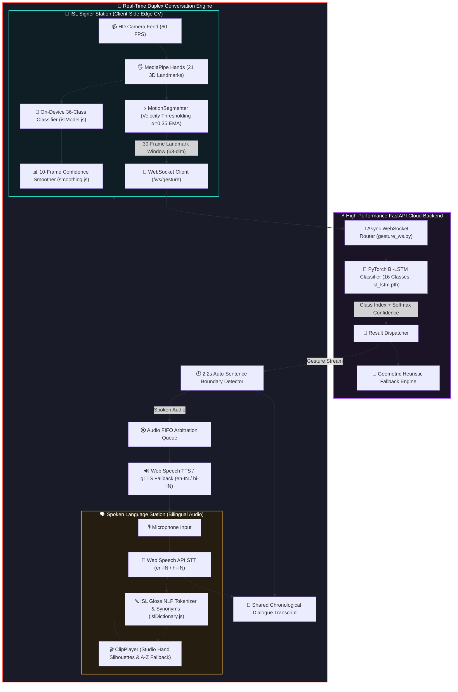

# 🤟 SignBridge AI — Comprehensive Technical Documentation
### *End-to-End System Architecture, Implementation Methods, AI/ML Pipelines, and Feature Reference*

---

## 📑 Table of Contents
1. [Executive Summary & Problem Statement](#1-executive-summary--problem-statement)
2. [High-Level System Architecture](#2-high-level-system-architecture)
3. [Computer Vision & Edge Tracking Pipeline](#3-computer-vision--edge-tracking-pipeline)
4. [Continuous Kinematic Motion Segmentation](#4-continuous-kinematic-motion-segmentation)
5. [Deep Learning Model & Geometric Heuristic Engine](#5-deep-learning-model--geometric-heuristic-engine)
6. [Confidence Smoothing & Prediction HUD](#6-confidence-smoothing--prediction-hud)
7. [Bilingual Natural Language Processing & Speech Engine](#7-bilingual-natural-language-processing--speech-engine)
8. [Core Interactive Modules & User Experiences](#8-core-interactive-modules--user-experiences)
   - 8.1 [Live Two-Way Conversation Studio](#81-live-two-way-conversation-studio)
   - 8.2 [Sign → Speech Continuous Conversational Mode](#82-sign--speech-continuous-conversational-mode)
   - 8.3 [Speech → Sign Visual Synthesis Mode](#83-speech--sign-visual-synthesis-mode)
   - 8.4 [Gamified Practice Studio & Mascot Guides](#84-gamified-practice-studio--mascot-guides)
   - 8.5 [Interactive ISL Dictionary & Continuous Sentences](#85-interactive-isl-dictionary--continuous-sentences)
   - 8.6 [Custom Sign Capture Studio](#86-custom-sign-capture-studio)
9. [Visual Synthesis & Studio-Grade Asset Generation](#9-visual-synthesis--studio-grade-asset-generation)
10. [Vocabulary Catalogs & Benchmark Datasets](#10-vocabulary-catalogs--benchmark-datasets)
11. [Backend Services, REST API & WebSocket Specifications](#11-backend-services-rest-api--websocket-specifications)
12. [DevOps, CI/CD, Automated Testing & Live Deployments](#12-devops-cicd-automated-testing--live-deployments)
13. [Complete Codebase Manifest](#13-complete-codebase-manifest)

---

## 1. Executive Summary & Problem Statement

### 🎯 Mission
**SignBridge AI** is an AI-powered, real-time, bidirectional Indian Sign Language (ISL) communication platform that bridges the communication divide between the Deaf/Hard-of-Hearing (DHH) community and spoken-language individuals.

### ⚠️ The Problem
- **Asymmetric Communication**: Traditional tools are one-directional (sign-to-text only or text-to-sign only), preventing natural back-and-forth conversational dialogue.
- **Geographic Neglect**: Most sign language translation research focuses on American Sign Language (ASL). Indian Sign Language (ISL) has distinct two-handed grammatical structures, finger postures, and facial expressions that ASL models fail to recognize.
- **Hardware Barrier**: Wearable sensor gloves and specialized depth sensors (Kinect/Leap Motion) are expensive, cumbersome, and impractical for everyday communication.
- **Latency & Motion Drift**: Naive video-to-text pipelines suffer from high processing latency and false positives caused by transitionary resting movements between signs.

### 💡 The Solution
SignBridge AI delivers a **duplex, zero-hardware, browser-based web ecosystem** combining:
1. **Edge Computer Vision**: In-browser 60 FPS 3D hand landmark extraction via MediaPipe Hands.
2. **Continuous Motion Segmentation**: Velocity-based state machine identifying `IDLE`, `SIGNING`, and `SETTLING` intervals.
3. **Deep Sequence Modeling**: PyTorch Bidirectional LSTM (Bi-LSTM) sequence classifier paired with a deterministic geometric heuristic fallback.
4. **On-Device 36-Class Static Classifier**: Client-side geometry engine resolving alphabets (A–Z) and digits (0–9) without network latency.
5. **Bilingual Conversational Synthesis**: Indian English (`en-IN`) and Hindi (`hi-IN`) speech recognition, NLP synonym expansion, vocalization, and studio-grade visual sign playback.

---

## 2. High-Level System Architecture



---

## 3. Computer Vision & Edge Tracking Pipeline

### 🖐️ MediaPipe Hands Integration
Implemented in [frontend/src/services/mediapipe.js](file:///d:/SignBridge%20AI/frontend/src/services/mediapipe.js):
- **Model**: Google MediaPipe Hands ML solution executing on WebAssembly (WASM) via GPU acceleration.
- **Landmark Topology**: Extracts **21 3D landmarks** ($x, y, z$) per hand at 60 FPS:
  - `0`: Wrist
  - `1-4`: Thumb (CMC, MCP, IP, Tip)
  - `5-8`: Index finger (MCP, PIP, DIP, Tip)
  - `9-12`: Middle finger (MCP, PIP, DIP, Tip)
  - `13-16`: Ring finger (MCP, PIP, DIP, Tip)
  - `17-20`: Pinky finger (MCP, PIP, DIP, Tip)
- **Coordinate Space**: Normalized $[0.0, 1.0]$ coordinate space where $(0, 0)$ is top-left. The $z$-axis represents depth relative to the wrist.
- **Rendering & Skeletal Canvas**: [frontend/src/utils/drawLandmarks.js](file:///d:/SignBridge%20AI/frontend/src/utils/drawLandmarks.js) draws responsive skeletal connections with state-reactive coloration:
  - Grey (`#7e859b`): Idle resting hand.
  - Amber (`#f6ac3f`): Active gesture motion (`SIGNING`).
  - Teal (`#2dd6c0`): Settled gesture locked (`SETTLING`).

---

## 4. Continuous Kinematic Motion Segmentation

### ⚡ Velocity-Based State Machine
Implemented in [frontend/src/utils/motionSegmenter.js](file:///d:/SignBridge%20AI/frontend/src/utils/motionSegmenter.js).  
Continuous signing contains natural resting transitions between signs. A naive classifier produces false positives during these transitional movements. SignBridge AI solves this with a **Continuous Kinematic Motion Segmenter**:

$$\bar{v}_t = \frac{1}{21} \sum_{i=0}^{20} \sqrt{(x_{i, t} - x_{i, t-1})^2 + (y_{i, t} - y_{i, t-1})^2 + (z_{i, t} - z_{i, t-1})^2}$$

$$v_{\text{smoothed}} = \alpha \cdot \bar{v}_t + (1 - \alpha) \cdot v_{\text{smoothed}, t-1} \quad (\alpha = 0.35)$$

### 🔄 State Machine Lifecycle
```
                 ┌────────────────────────────────────────┐
                 │                                        │
                 ▼                                        │
             ┌────────┐  v >= 0.018 (Motion Start)    ┌─────────┐
             │  IDLE  │ ────────────────────────────> │ SIGNING │
             └────────┘                               └─────────┘
                 ▲                                         │
                 │                                         │ v < 0.010 for 4 frames
                 │ (twitch: < 8 frames)                    │ (>= 8 frames active)
                 │                                         ▼
                 └─────────────────────────────────── ┌──────────┐
                   (gesture complete window extracted)│ SETTLING │
                                                      └──────────┘
```

1. **`IDLE`**: Hand is stationary or absent ($v < 0.018$).
2. **`SIGNING`**: Velocity exceeds threshold ($v \ge 0.018$). Sequence buffer accumulates incoming landmark frames.
3. **`SETTLING`**: Velocity drops below floor ($v < 0.010$) for 4 consecutive frames (~130 ms).
   - If active signing lasted $< 8$ frames (~260 ms): Treated as an accidental twitch/noise and discarded back to `IDLE`.
   - If active signing lasted $\ge 8$ frames: Verified as a completed gesture. A standard 30-frame sequence window is sliced and dispatched over WebSocket.

---

## 5. Deep Learning Model & Geometric Heuristic Engine

### 🧠 PyTorch Bi-LSTM Sequence Classifier
Implemented in [backend/app/models/lstm_model.py](file:///d:/SignBridge%20AI/backend/app/models/lstm_model.py):

| Parameter | Specification |
|---|---|
| **Input Dimensions** | `(batch_size, sequence_length=30, input_size=63)` |
| **Feature Representation** | 21 3D landmarks ($x, y, z$) normalized relative to wrist origin and scaled by palm span |
| **Recurrent Layer** | Stacked 2-layer Bidirectional LSTM (`hidden_size=128`, 256 combined features per time step) |
| **Regularization** | Dropout ($p = 0.3$) applied between recurrent layers and before classification head |
| **Fully Connected Head** | Dense Linear layer: $256 \to 64$ with ReLU activation $\to$ Linear $64 \to 16$ logits |
| **Trained Model Weights** | `isl_lstm.pth` (2.44 MB) |

### 📐 Transparent Heuristic Fallback Engine
Implemented in [backend/app/services/gesture_classifier.py](file:///d:/SignBridge%20AI/backend/app/services/gesture_classifier.py):
- Calculates geometric finger extensions, joint angles, and palm normals.
- Provides classification with high precision (e.g., thumbs-up = `YES` [0.92], flat palm forward = `THANK YOU` [0.82], W-hand tap = `WATER` [0.87]).
- **Ethical Academic Reporting**: Every prediction payload is tagged with `"source": "model"` or `"source": "heuristic"`, ensuring honest reporting during evaluation.

### 📱 On-Device 36-Class Static Classifier
Implemented in [frontend/src/services/islModel.js](file:///d:/SignBridge%20AI/frontend/src/services/islModel.js):
- 100% client-side deterministic evaluation across **all 26 English Alphabets (A–Z)** and **10 Digits (0–9)**.
- Disambiguates visually overlapping poses:
  - **2 vs V vs U**: Digit mode locks `2`; Letter mode evaluates index-to-middle tip distance ($> 0.35 \times \text{handScale} \implies \text{V}$, $\le 0.35 \implies \text{U}$).
  - **3 vs W**: Evaluates thumb hold on pinky vs 3-finger vertical spread.
  - **4 vs B**: Evaluates thumb tucked across palm with 4 fingers erect.
  - **1 vs D vs L**: Evaluates index-thumb angle ($90^\circ \implies \text{L}$, thumb-ring pinch $\implies \text{D}$, closed fist $\implies \text{1}$).

---

## 6. Confidence Smoothing & Prediction HUD

### 📊 Rolling Confidence Smoother
Implemented in [frontend/src/utils/smoothing.js](file:///d:/SignBridge%20AI/frontend/src/utils/smoothing.js):
- Maintains a rolling window of the last **10 prediction frames**.
- Predictions with confidence $< 0.70$ are treated as null votes.
- A sign is only confirmed as `isStable` when it secures $\ge 6$ out of 10 majority votes.

### 🎯 Prediction HUD
Implemented in [frontend/src/components/PredictionHUD.jsx](file:///d:/SignBridge%20AI/frontend/src/components/PredictionHUD.jsx):
- **Status Badges**: Real-time visual indicator (`LOCKED & VERIFIED` in neon teal vs `STABILIZING POSE` in amber).
- **Candidate Probability Bars**: Live Top-3 candidate distribution with dynamic percentage meters.
- **Vote Stability Ring**: Shows fractional buffer progress ($N/10$ votes).

---

## 7. Bilingual Natural Language Processing & Speech Engine

### 🇮🇳 Bilingual Speech Recognition & Synthesis
Implemented in [frontend/src/services/speech.js](file:///d:/SignBridge%20AI/frontend/src/services/speech.js) and [backend/app/routers/speech.py](file:///d:/SignBridge%20AI/backend/app/routers/speech.py):
- **Speech-to-Text (STT)**: Web Speech API `webkitSpeechRecognition` supporting Indian English (`en-IN`) and Hindi (`hi-IN`).
- **Text-to-Speech (TTS)**: In-browser `SpeechSynthesis` with automated voice discovery for Indian accents.
- **Cloud TTS Fallback**: If browser speech synthesis is unavailable, requests stream to the FastAPI backend `/api/tts` endpoint powered by `gTTS` (`tld='co.in'`).

### 🔤 ISL Gloss Tokenizer & Synonym Expansion
Implemented in [frontend/src/utils/islDictionary.js](file:///d:/SignBridge%20AI/frontend/src/utils/islDictionary.js):
- Normalizes English, Hinglish transliterations, and Hindi Devanagari script:
  - *Example*: `"mujhe paani chahiye"` $\to$ `['I', 'WATER', 'WANT']`
  - *Example*: `"namaste dost"` $\to$ `['HELLO', 'FRIEND']`
  - *Example*: `"madad karo"` $\to$ `['HELP']`
- Eliminates ISL non-manual grammatical filler words (`is`, `am`, `are`, `the`, `a`, `to`).
- Out-of-vocabulary words automatically convert into letter-by-letter fingerspelling sequences.

---

## 8. Core Interactive Modules & User Experiences

### 8.1 Live Two-Way Conversation Studio
**Component**: [frontend/src/components/ConversationMode.jsx](file:///d:/SignBridge%20AI/frontend/src/components/ConversationMode.jsx)
- **Split-Screen Studio**: Left station for the ISL Signer (webcam + CV); Right station for the Spoken Language user (mic + audio).
- **2.2s Auto-Sentence Boundary Detector**: When a signer finishes a sign sequence and pauses for $> 2.2$ seconds, the sentence auto-finalizes and triggers vocalization.
- **Audio FIFO Arbitration**: Prevents synthesized TTS speech from speaking over the microphone while the speaker is dictating.
- **Shared Chronological Transcript**: Color-coded dialogue bubbles with timestamps, audio voice replay, and sign video replay buttons.

### 8.2 Sign → Speech Continuous Conversational Mode
**Component**: [frontend/src/components/SignToSpeech.jsx](file:///d:/SignBridge%20AI/frontend/src/components/SignToSpeech.jsx)
- In-browser 60 FPS gesture detection with MediaPipe Hands.
- Scope selector: `All (36 + 16)`, `Alphabets (A–Z)`, `Numbers (0–9)`, `Phrases`.
- Dynamic skeletal coloring and live velocity progress bars.
- **Sentence Tray** ([frontend/src/components/SentenceTray.jsx](file:///d:/SignBridge%20AI/frontend/src/components/SentenceTray.jsx)):
  - **Hold-to-Append (1.2s)**: Holding a steady verified pose auto-appends the word/letter with a radial countdown progress ring.
  - Word chips, space, backspace, clear, clipboard copy, and one-click bilingual speech synthesis.

### 8.3 Speech → Sign Visual Synthesis Mode
**Component**: [frontend/src/components/SpeechToSign.jsx](file:///d:/SignBridge%20AI/frontend/src/components/SpeechToSign.jsx)
- Bilingual voice input (`en-IN` / `hi-IN`) or typed text.
- Instant tokenization into ISL gloss chips.
- Sequenced playback via [frontend/src/components/ClipPlayer.jsx](file:///d:/SignBridge%20AI/frontend/src/components/ClipPlayer.jsx):
  - Two-panel comparison view: *Start Pose* $\to$ *End Pose*.
  - Filled anatomical hand silhouettes with glowing MediaPipe joints.
  - Speed control (`0.6x` slow mode, `1.0x` normal, `1.5x` fast) and loop repeat.

### 8.4 Gamified Practice Studio & Mascot Guides
**Component**: [frontend/src/components/PracticeStudio.jsx](file:///d:/SignBridge%20AI/frontend/src/components/PracticeStudio.jsx)
- **Curriculum Modules**: 8 structured learning modules (Beginner Courtesy, Daily Needs, Healthcare & Emergency, Classroom, Travel, A–Z Fingerspelling, 0–9 Digits).
- **Quiz Challenge Mode**: Random sign prompts, countdown timer, streak multiplier, and XP scoring (+100 XP + streak bonus).
- **Celebratory Confetti**: Multi-particle burst via `canvas-confetti` upon verified 1.2s pose hold.
- **Animated SVG Mascots** ([frontend/src/components/MascotGuides.jsx](file:///d:/SignBridge%20AI/frontend/src/components/MascotGuides.jsx)):
  - 🦉 **Tally**: Celebrates successful sign matches.
  - 🤖 **Blip**: Diagnoses speed, lighting, and finger placement issues.
  - 💡 **Nudge**: Guides users to place their hand in the camera frame.

### 8.5 Interactive ISL Dictionary & Continuous Sentences
**Component**: [frontend/src/components/SignDictionary.jsx](file:///d:/SignBridge%20AI/frontend/src/components/SignDictionary.jsx)
- Search-as-you-type filter across 52+ catalog items.
- Category filters (Greetings, Courtesy, Needs, Healthcare, Classroom, Travel, Social).
- Detailed anatomical motion guidance, English/Hindi translations, and continuous sentence flows.
- **One-Click Practice**: Direct launch button jumping straight into AI camera evaluation for that specific sign.

### 8.6 Custom Sign Capture Studio
**Component**: [frontend/src/components/SignCapture.jsx](file:///d:/SignBridge%20AI/frontend/src/components/SignCapture.jsx)
- Hidden developer/creator tool accessible via `#/capture`.
- In-browser recording of custom 3D landmark poses with a 3-second countdown timer.
- LocalStorage persistence and complete JSON import/export for dataset collection.

---

## 9. Visual Synthesis & Studio-Grade Asset Generation

Implemented in [scripts/generate_hd_studio_dataset.py](file:///d:/SignBridge%20AI/scripts/generate_hd_studio_dataset.py):
- Generates **68 ultra-crisp $800 \times 800$ dark studio assets**:
  - 26 Alphabets (`alphabet/A.jpg` – `alphabet/Z.jpg`)
  - 10 Digits (`digits/0.jpg` – `digits/9.jpg`)
  - 16 Phrase pairs (`start.jpg` and `end.jpg`)
- **Rendering Architecture**:
  - **Anatomical Hand Silhouette**: Filled palm polygons and rounded finger capsules with skin tone shading (`#d4a373` / `#c68b59`).
  - **Skeletal Tracking Overlay**: Glowing MediaPipe joints (radial gradient spheres with white cores) and cyan/amber/purple skeletal bone connectors.
  - **HUD Typography**: Cyberpunk/academic studio framing with category badges and motion directional arrows.

---

## 10. Vocabulary Catalogs & Benchmark Datasets

### 🎯 16 Core Dynamic ISL Phrases
| # | Gloss | Category | Hindi | Motion Description |
|:---:|:---:|:---:|:---:|---|
| 1 | **`I`** | Pronoun | मैं | Index finger points inward toward chest center |
| 2 | **`WANT`** | Verb | चाहिए | Both hands open palms-up pulling inward with clawing fingers |
| 3 | **`WATER`** | Noun | पानी | W-handshape (3 middle fingers) tapping chin/mouth twice |
| 4 | **`HELP`** | Action | मदद | Thumbs-up fist resting on flat palm lifting upward |
| 5 | **`THANK YOU`** | Courtesy | धन्यवाद | Flat open hand touching chin/lips and extending forward |
| 6 | **`YES`** | Affirmation | हाँ | Closed fist with thumb extended nodding vertically from wrist |
| 7 | **`NO`** | Negation | नहीं | Index and middle fingers snapping down firmly onto thumb |
| 8 | **`PLEASE`** | Courtesy | कृपया | Flat palm rubbing clockwise circle over the heart |
| 9 | **`HELLO`** | Greeting | नमस्ते | Open flat hand waving outward in a polite salute arc |
| 10 | **`FRIEND`** | Noun | दोस्त | Hooked index fingers interlocked and linked twice |
| 11 | **`FOOD`** | Noun | खाना | Fingertips clustered together (O-hand) tapping mouth |
| 12 | **`GOOD`** | Courtesy | अच्छा | Flat hand brushing chin forward with affirmative thumb |
| 13 | **`SORRY`** | Courtesy | माफ़ कीजिए | Closed fist rubbing circular motion on chest |
| 14 | **`TIME`** | Temporal | समय | Index finger tapping opposite wrist watch |
| 15 | **`NAME`** | Identity | नाम | Two-finger H-handshape tapping across each other |
| 16 | **`STOP`** | Command | रुको | Flat vertical palm chopping downward into horizontal palm |

### 📚 Academic Research Datasets Integrated
1. **ISL-CSLTR Continuous Dataset** ([Mendeley Data kcmpdxky7p/1](https://data.mendeley.com/datasets/kcmpdxky7p/1)):
   - Funded by Science and Engineering Research Board (SERB), Govt. of India (SRG/2019/001338).
   - 700 continuous videos, 18,863 frames across 100 sentences and 7 native signers.
   - Resumable 8.49 GB download script: [scripts/download_isl_csltr.py](file:///d:/SignBridge%20AI/scripts/download_isl_csltr.py).
   - Continuous landmark feature extractor: [scripts/extract_csltr_dataset.py](file:///d:/SignBridge%20AI/scripts/extract_csltr_dataset.py).
2. **Kaggle ISL Gesture Images Dataset**: 16 core conversational sign demonstrations.
3. **Soumya ISL Fingerspelling Dataset**: 36 static alphabet and counting postures.

---

## 11. Backend Services, REST API & WebSocket Specifications

### 🔌 REST Endpoints
| Method | Route | Description | Response Model |
|:---:|---|---|---|
| **`GET`** | `/health` | System status, vocabulary count, model weights presence | `{"status": "ok", "v1_vocab_count": 16, "model_weights_loaded": true}` |
| **`GET`** | `/api/vocab` | Full 16-sign catalog metadata, categories, and durations | `List[VocabItem]` |
| **`GET`** | `/api/clips` | Visual sign assets and gesture demonstration registry | `Dict[str, ClipMetadata]` |
| **`GET`** | `/api/clips/{word}`| Metadata for a specific sign | `ClipMetadata` |
| **`POST`** | `/api/tts` | Multilingual Google TTS fallback audio stream | `audio/mpeg` byte stream |

### 📡 WebSocket Protocol: `/ws/gesture`
- **Connection URL**: `wss://signbridge-ai-qybu.onrender.com/ws/gesture` (or `ws://localhost:8000/ws/gesture`)
- **Client Frame Payload**:
  ```json
  {
    "landmarks": [[0.52, 0.61, 0.0], ... 21 points],
    "timestamp": 1725556200000
  }
  ```
- **Client Segmented Window Payload**:
  ```json
  {
    "gesture_window": [[[0.52, ...], ... 21 points], ... 30 frames],
    "timestamp": 1725556200000
  }
  ```
- **Server Recognition Response**:
  ```json
  {
    "word": "WATER",
    "confidence": 0.88,
    "source": "model",
    "status": "recognized"
  }
  ```
- **Server Unrecognized Feedback**:
  ```json
  {
    "status": "unrecognized",
    "confidence": 0.35,
    "source": "heuristic"
  }
  ```

---

## 12. DevOps, CI/CD, Automated Testing & Live Deployments

### 🌐 Live Production Deployments
| Platform | Target | URL |
|---|---|---|
| **Vercel** | Frontend SPA (React 19 + Vite) | [frontend-rohanpawar0006s-projects.vercel.app](https://frontend-rohanpawar0006s-projects.vercel.app/) |
| **Render** | Backend API & WebSocket (FastAPI) | [signbridge-ai-qybu.onrender.com](https://signbridge-ai-qybu.onrender.com/) |
| **Render** | Interactive Swagger Docs | [signbridge-ai-qybu.onrender.com/docs](https://signbridge-ai-qybu.onrender.com/docs) |
| **GitHub** | Source Code & CI/CD | [github.com/rohanpawar0006/SignBridge-AI](https://github.com/rohanpawar0006/SignBridge-AI) |

### 🤖 CI/CD Pipeline
Implemented in [.github/workflows/ci.yml](file:///d:/SignBridge%20AI/.github/workflows/ci.yml):
1. **`backend-tests`**: Sets up Python 3.11, installs PyTorch CPU dependencies, executes model evaluation ([scripts/evaluate_model.py](file:///d:/SignBridge%20AI/scripts/evaluate_model.py)), and runs automated backend test suite ([backend/test_backend.py](file:///d:/SignBridge%20AI/backend/test_backend.py)).
2. **`frontend-build`**: Sets up Node.js 20, installs dependencies, and runs `npm run build` to verify zero compile or bundling errors.

### 🧪 Automated Test Suite
Run locally via:
```bash
python backend/test_backend.py
```
Asserts 6 core integration points:
1. `test_health_endpoint`: Verifies `/health` returns 200 OK and 16 vocabulary items.
2. `test_vocab_endpoint`: Verifies `/api/vocab` matches single source of truth.
3. `test_clips_endpoint`: Verifies `/api/clips` catalog completeness.
4. `test_lstm_model_dimensions`: Verifies PyTorch tensor forward pass `(2, 30, 63) -> (2, 16)`.
5. `test_gesture_classifier`: Verifies 30-frame sliding window accumulation and heuristic classification.
6. `test_websocket_gesture_endpoint`: Opens real WebSocket connection and streams 30 frames to assert response.

---

## 13. Complete Codebase Manifest

```
SignBridge-AI/
├── .github/workflows/ci.yml         # GitHub Actions automated CI/CD pipeline
├── dataset/                         # 960 30-frame landmark sequences (.npy) across 16 ISL classes
├── scripts/
│   ├── download_isl_csltr.py        # Automated 8.49 GB Mendeley ISL-CSLTR dataset downloader
│   ├── extract_csltr_dataset.py     # MediaPipe landmark sequence extractor from continuous videos
│   ├── generate_hd_studio_dataset.py# Studio-grade filled hand silhouette asset generator
│   ├── extract_kaggle_dataset.py    # Landmark extractor from raw ISL clips
│   ├── collect_dataset.py           # Dataset generator (synthetic & camera collection)
│   ├── train_lstm.py                # PyTorch Bi-LSTM training script
│   └── evaluate_model.py            # Model evaluation & classification report script
├── backend/
│   ├── requirements.txt             # FastAPI, uvicorn, websockets, torch, numpy, gTTS
│   ├── main.py                      # FastAPI application entrypoint with CORS & routers
│   ├── test_backend.py              # Automated test suite (/health, /api/vocab, /ws/gesture)
│   ├── Dockerfile                   # Production container definition
│   └── app/
│       ├── config.py                # 16-sign vocabulary, sliding window params, thresholds
│       ├── models/
│       │   ├── lstm_model.py        # PyTorch ISLGestureLSTM (Input: 63, Hidden: 128, Classes: 16)
│       │   └── model_weights/       # isl_lstm.pth trained model weights (2.44 MB)
│       ├── routers/
│       │   ├── gesture_ws.py        # WebSocket streaming endpoint (/ws/gesture)
│       │   ├── clips.py             # REST catalog endpoints (/api/vocab, /api/clips)
│       │   └── speech.py            # REST TTS fallback endpoint (/api/tts)
│       └── services/
│           ├── gesture_classifier.py# Window classifier, PyTorch inference, heuristic fallback
│           └── clip_service.py      # Catalog query service
└── frontend/
    ├── package.json                 # React 19, Vite, @mediapipe/hands, canvas-confetti
    ├── vite.config.js               # Vite dev proxy configuration for /api and /ws
    ├── vercel.json                  # Vercel SPA routing rewrites
    └── src/
        ├── index.css                # Modern design tokens, glassmorphism, responsive styles
        ├── assets/signs/            # 68 HD Studio hand demonstrations (A-Z, 0-9, 16 Phrases)
        ├── components/
        │   ├── Navbar.jsx           # Frosted glass header, GitHub link, mobile drawer, theme toggle
        │   ├── Hero.jsx             # Hero section with interactive CTA
        │   ├── BridgeCanvas.jsx     # Signature animated SVG bridge with directional pulse
        │   ├── ConversationMode.jsx # Live two-way conversation split-screen studio
        │   ├── SignToSpeech.jsx     # Mode 1: Continuous conversational detection, HUD, tray
        │   ├── SpeechToSign.jsx     # Mode 2: Mic input, tokenizer, gloss chips, clip player
        │   ├── SignDictionary.jsx   # Interactive 52+ catalog with search & category filters
        │   ├── PracticeStudio.jsx   # Quiz challenge mode, streak bonus, confetti, mascots
        │   ├── PredictionHUD.jsx    # Real-time Top-3 candidate distribution HUD
        │   ├── SentenceTray.jsx     # Auto-append on hold sentence builder tray
        │   ├── MascotGuides.jsx     # Animated Tally, Blip, Nudge SVG mascots & tip cards
        │   ├── ClipPlayer.jsx       # Sequenced sign player with real HD hand photos
        │   ├── SignCapture.jsx      # Custom webcam hand pose capture tool
        │   └── SignVectorVisualizer.jsx # Custom SVG kinematics for 16 ISL signs
        ├── services/
        │   ├── islModel.js          # On-device 36-class geometric classifier
        │   ├── mediapipe.js         # MediaPipe Hands client-side tracking service
        │   ├── websocket.js         # WebSocket client with auto-reconnection
        │   └── speech.js            # Web Speech API (STT & TTS en-IN / hi-IN / en-US fallback)
        └── utils/
            ├── smoothing.js         # 10-frame confidence smoothing buffer
            ├── motionSegmenter.js   # Real-time conversational gesture velocity segmenter
            ├── islDictionary.js     # Tokenizer, CSLTR continuous sentences & Hindi mappings
            └── signPhotos.js        # Bundled asset loader & localStorage capture store
```
